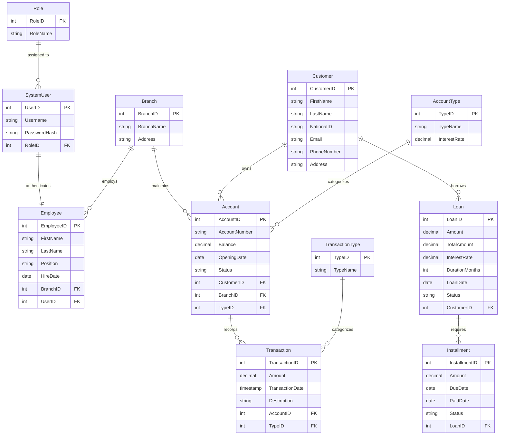

# Bank Management System

A secure, PostgreSQL-driven banking management system with a Python desktop GUI. It handles customers, accounts, loans, installments, and fund transfers while enforcing strict **3NF normalization**, **SQL injection protection**, and **database-level integrity rules**.

> Database Management course project, Shiraz University (Bachelor's level)

**Authors:** Moein Yeganeh


---

## Table of Contents

- [Features](#-features)
- [Tech Stack & Architecture](#-tech-stack--architecture)
- [Database Design](#-database-design)
- [Security](#-security)
- [Key SQL Examples](#-key-sql-examples)
- [Getting Started](#-getting-started)
- [Project Structure](#-project-structure)
- [Bonus Features](#-bonus-features)
- [Authors](#-authors)
- [License](#-license)

---

## Features

| Module | Capabilities |
|---|---|
| **Customer Management** | Register, search, update, and delete customers (name, national ID, contact details) |
| **Account Management** | Open savings/checking accounts, assign them to customers and branches, view details, close accounts (Active/Closed) |
| **Transaction Processing** | Deposits, withdrawals, and atomic inter-account transfers |
| **Loan Management** | Register loans (amount, interest rate, duration), view loan status, record installment payments |
| **Employee & Role Management** | Manage employee records and system users with role-based access (Administrator, Employee) |
| **Audit Trail** | Automatic logging of balance changes via a database trigger |

---

## Tech Stack & Architecture

The project uses a **two-tier architecture**:

1. **Database layer:** PostgreSQL, normalized to Third Normal Form (3NF) to eliminate redundancy.
2. **Application layer:** Python desktop application built with **CustomTkinter**, communicating with the database through the **psycopg2** adapter.

All core database logic is written directly in **SQL** (`CREATE TABLE`, `ALTER TABLE`, constraints, joins, aggregates, views, stored procedures, triggers). No ORM is used.

---

## Database Design

### ER / Relational Schema



### Tables

| # | Table | Purpose |
|---|---|---|
| 1 | `Role` | Permission levels (e.g., Administrator, Employee) |
| 2 | `SystemUser` | Login credentials (username + bcrypt password hash) |
| 3 | `Branch` | Physical branch locations |
| 4 | `Employee` | Staff information, linked to login credentials and a branch |
| 5 | `Customer` | Customer identification and contact information |
| 6 | `AccountType` | Account categories (Savings, Checking) with their interest rate |
| 7 | `Account` | Individual accounts: owner, branch, type, balance, status |
| 8 | `TransactionType` | Financial event categories (Transfer, Deposit, Withdrawal) |
| 9 | `Transaction` | Every financial transaction: amount, timestamp, affected account |
| 10 | `Loan` | Loans granted to customers: principal, interest rate, duration, total repayment |
| 11 | `Installment` | Scheduled loan payments: due date, paid date, status |
| – | `AuditLog` | Written automatically by the audit trigger (table name, action, details) |

### Relationships

| Relationship | Meaning |
|---|---|
| Role (1) : (N) SystemUser | One role can be assigned to many users; each user has exactly one role |
| SystemUser (1) : (1) Employee | Every employee has unique login credentials |
| Branch (1) : (N) Employee | A branch employs many employees; each employee has one primary branch |
| Branch (1) : (N) Account | Each account is tied to the branch where it was opened |
| Customer (1) : (N) Account | A customer can hold multiple accounts; each account has one owner |
| AccountType (1) : (N) Account | Each account has exactly one type |
| Customer (1) : (N) Loan | A customer can take multiple loans; each loan belongs to one customer |
| Loan (1) : (N) Installment | A loan generates multiple scheduled repayments |
| Account (1) : (N) Transaction | Each transaction record is tied to a single account |
| TransactionType (1) : (N) Transaction | Each transaction has exactly one type |

---

## Security

Security is a core part of the design and the non-negotiable constraints are enforced at multiple layers.

### SQL injection prevention
The application never concatenates user input into SQL strings. All queries use **parameterized queries** via psycopg2's `%s` placeholders, so input is always treated as data, never as executable SQL.

```python
# ✅ Safe: parameterized
cursor.execute("SELECT * FROM SystemUser WHERE Username = %s", (username,))

# ❌ Never done in this project: string concatenation
# cursor.execute("SELECT * FROM SystemUser WHERE Username = '" + username + "'")
```

### Password storage
Passwords are never stored in plaintext. At registration the app generates a **salted bcrypt hash** and stores it in `SystemUser.PasswordHash`. At login, the entered password is verified against the stored hash.

### Authentication & authorization
- Login mechanism for all users
- Role-based access control with at least two roles: **Administrator** and **Employee**, each with defined privileges

### Database-level protection
- **`CHECK` constraints** prevent negative balances, even if the application has a bug
- **Atomic transfers:** if any step of a transfer fails, the whole transaction is rolled back
- **Audit trigger** records every account balance update

---

## Key SQL Examples

### 1. View: customer account summary (JOIN + VIEW)

```sql
CREATE OR REPLACE VIEW vw_CustomerAccounts AS
SELECT
    c.NationalID,
    c.FirstName,
    c.LastName,
    c.Email,
    a.AccountNumber,
    a.Balance,
    b.BranchName,
    aty.TypeName AS AccountType
FROM Customer c
JOIN Account a      ON c.CustomerID = a.CustomerID
JOIN Branch b       ON a.BranchID = b.BranchID
JOIN AccountType aty ON a.TypeID = aty.TypeID;
```

### 2. Aggregate query: total balance per branch (SUM + GROUP BY)

```sql
SELECT
    b.BranchName,
    COUNT(a.AccountID) AS TotalAccounts,
    SUM(a.Balance)     AS TotalBranchBalance
FROM Branch b
LEFT JOIN Account a ON b.BranchID = a.BranchID
GROUP BY b.BranchID, b.BranchName
ORDER BY TotalBranchBalance DESC;
```

### 3. Stored procedure: secure fund transfer (atomic)

```sql
CREATE OR REPLACE PROCEDURE TransferFunds(
    sender_id INT,
    receiver_id INT,
    transfer_amount DECIMAL
)
LANGUAGE plpgsql
AS $$
DECLARE
    transfer_type_id INT;
BEGIN
    -- Look up the 'Transfer' type dynamically to avoid hardcoding
    SELECT TypeID INTO transfer_type_id
    FROM TransactionType WHERE TypeName = 'Transfer' LIMIT 1;
    IF transfer_type_id IS NULL THEN
        RAISE EXCEPTION 'Transaction Type "Transfer" not found in TransactionType table.';
    END IF;

    -- 1. Deduct from sender
    UPDATE Account SET Balance = Balance - transfer_amount WHERE AccountID = sender_id;

    -- 2. Add to receiver
    UPDATE Account SET Balance = Balance + transfer_amount WHERE AccountID = receiver_id;

    -- 3. Log the sender's record (debit)
    INSERT INTO "Transaction" (AccountID, TypeID, Amount, TargetAccountID, Description)
    VALUES (sender_id, transfer_type_id, transfer_amount, receiver_id, 'Transfer Out');

    -- 4. Log the receiver's record (credit)
    INSERT INTO "Transaction" (AccountID, TypeID, Amount, Description)
    VALUES (receiver_id, transfer_type_id, transfer_amount, 'Transfer In');

EXCEPTION
    WHEN OTHERS THEN
        RAISE; -- Rolls back the entire transaction if any step fails
END;
$$;
```

### 4. Trigger: automated audit logging

```sql
CREATE OR REPLACE FUNCTION log_account_changes()
RETURNS TRIGGER
AS $$
BEGIN
    INSERT INTO AuditLog (TableName, Action, Details)
    VALUES (
        'Account',
        TG_OP,
        'Account ' || NEW.AccountNumber || ' balance changed to ' || NEW.Balance
    );
    RETURN NEW;
END;
$$ LANGUAGE plpgsql;

CREATE TRIGGER account_audit_trigger
AFTER UPDATE ON Account
FOR EACH ROW
EXECUTE FUNCTION log_account_changes();
```

---

## Getting Started

### Prerequisites

- Python 3.9+
- PostgreSQL 13+ (a version that supports `CREATE PROCEDURE`)
- `pip`

### 1. Clone the repository

```bash
git clone https://github.com/<your-username>/<your-repo>.git
cd <your-repo>
```

### 2. Create the database

```bash
createdb bank_db
psql -d bank_db -f database/schema.sql
```

### 3. Install dependencies

```bash
pip install customtkinter psycopg2-binary bcrypt
```

### 4. Configure the database connection

Set your PostgreSQL host, port, database name, user, and password in the application's configuration (or via environment variables, depending on your setup). **Never commit real credentials to the repository.**

### 5. Run the application

```bash
python main.py
```

---

## Bonus Features

Beyond the base requirements, the project implements:

- **bcrypt password hashing** for credential security
- **Database trigger** for automatic audit trails
- **Atomic stored procedure** for money transfers (no lost money if a server crashes mid-transfer)
- **Database-level `CHECK` constraints** preventing negative balances

---

## Author

- **Moein Yeganeh**

Shiraz University, 2026

---

## License

This project is licensed under the [MIT License](LICENSE).
